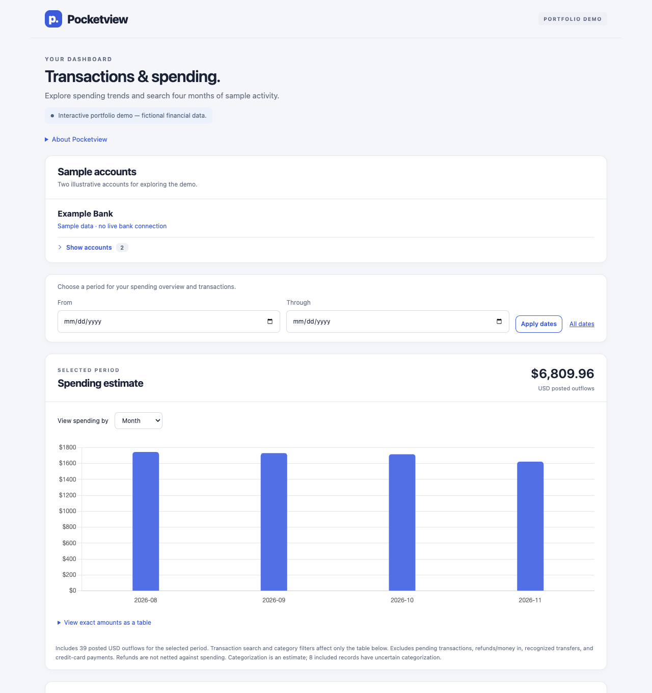

# Pocketview

[](https://github.com/dtommyhil/pocketview-public/actions/workflows/ci.yml)

A small personal finance dashboard built with Python, Flask, PostgreSQL, and Plaid
Sandbox. Connect a simulated bank account, import transactions, search activity,
and view spending by category or month.

**[Try the demo](https://pocketview-demo-o317.onrender.com)** · [Setup](docs/SETUP.md) · [Architecture](docs/ARCHITECTURE.md)



## Demo

The hosted version has two sample accounts and 56 fictional transactions. No login
is needed. Try searching for **Corner Coffee**, changing the date range, or
switching the chart between Category and Month. The free host can take about a
minute to wake up.

Bank connections, sync, and reconnect are available when running locally with
Plaid Sandbox credentials. The hosted version is read-only and doesn't call Plaid.

## What's in the app

- Plaid Link for connecting Sandbox accounts, with token exchange on the server
  and encrypted access tokens in PostgreSQL.
- Transaction imports through `/transactions/sync`, including added, changed,
  removed, and pending-to-posted transactions.
- Search, date and category filters, pagination, and a spending chart. Dates apply
  to both the chart and table; search and category filters apply to the table.
- Reconnect through Link update mode when a simulated bank login expires.
- Request logs and SQL queries for investigating failed syncs and connection issues.

## Sync and recovery

The main backend work is keeping imported data consistent. Each connection has a
saved cursor marking the last completed sync. Flask collects all update pages,
then commits the transaction changes and new cursor together. If a page fails,
the previous data and cursor stay in place.

Upserts prevent repeated updates from creating duplicate rows. A PostgreSQL lock
prevents two syncs from running for the same connection at once. Reconnecting
repairs the existing connection and keeps its transaction history.

In a live Sandbox recovery test, the same connection retained all 14 accounts and
48 transactions, with no duplicates. [Test results and remaining checks](docs/VALIDATION.md)
include the details.

```text
Browser
  │
  ▼
Flask ───────────────► Plaid Sandbox
  │                    connect, sync, reconnect
  ▼
PostgreSQL
accounts, transactions, encrypted tokens, sync cursors
```

The hosted demo reads fictional records from a separate database. Its bank-action
API routes are blocked on the server.

## Run locally

Requires Python 3.13+, Docker Desktop with Compose, and Node.js for JavaScript tests.
Start Docker Desktop, then:

```sh
git clone https://github.com/dtommyhil/pocketview-public.git
cd pocketview-public
python3 -m venv .venv
source .venv/bin/activate
python -m pip install -r requirements-dev.txt
python scripts/init_env.py
docker compose up -d --wait db
flask --app pocketview db-migrate
FLASK_DEBUG=0 flask --app pocketview run --host 127.0.0.1 --port 5087 --no-debugger --no-reload
```

Open **http://127.0.0.1:5087**. This starts without Plaid credentials; bank connection
requires your own Sandbox client ID and secret in the ignored local `.env`.
Follow [Sandbox setup and connection recovery](docs/SETUP.md) for those steps.
The initializer preserves any existing `.env`; keep its token encryption key.

## Run checks

With the virtual environment active and Docker Desktop running:

```sh
docker compose up -d --wait db
ruff check .
ruff format --check .
python -m pip check
node --check pocketview/static/app.js
node --check pocketview/static/charts.js
node --test tests/link.test.cjs
POCKETVIEW_TEST_POSTGRES=1 pytest -q
```

PostgreSQL tests use disposable schemas rather than the app's tables. Without
`POCKETVIEW_TEST_POSTGRES=1` or a separate `TEST_DATABASE_URL`, those tests skip.
[GitHub Actions](.github/workflows/ci.yml) runs the full checks against disposable
PostgreSQL 17 without Plaid credentials. Plaid responses are mocked in CI;
actual Sandbox and public-demo browser results are documented separately.

## Limits

This is a Sandbox project with one local demo owner. It doesn't support real bank
accounts, multi-user login, OAuth redirect flows, or automatic webhook updates.
After the initial import, use Sync to fetch available changes.

Spending is an estimate of posted USD outflows. Pending transactions, inflows,
refunds, recognized transfers, and credit-card payments are excluded. Refunds
aren't subtracted from spending, and categories can be imperfect.

Sync pages are buffered in memory to keep the implementation small. A larger
import workload would need a different staging approach.

## Code and notes

| File | What it handles |
| --- | --- |
| `pocketview/routes.py` | Dashboard requests and API endpoints |
| `pocketview/sync.py` | Sync pagination, retries, and atomic updates |
| `pocketview/store.py` | Database queries and spending calculations |
| `pocketview/connections.py` | Connection health and recovery |
| `pocketview/plaid.py` | Plaid Sandbox requests |
| `pocketview/config.py` | Environment settings and validation |
| `pocketview/demo.py` | Sample data for the hosted version |
| `migrations/`, `tests/` | SQL migrations and automated tests |

- [Local setup](docs/SETUP.md) and [troubleshooting](docs/TROUBLESHOOTING.md)
- [Architecture](docs/ARCHITECTURE.md) and [test results](docs/VALIDATION.md)
- [Hosting](docs/DEPLOYMENT.md)
- [Security](SECURITY.md) and [third-party licenses](THIRD_PARTY_NOTICES.md)
